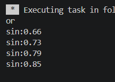

# Documentation TD1 

 ## TD 1 
 Réalisation des 4 premiers tutoriels
 Problème de port à cause du cable, on l'a donc remplacé puisqu'il ne nous permettait pas d'upload complètement.

 Envoie d'un sinus au microcontrôleur et affichage sur le moniteur série : 

   

Données transmises entre notre carte et l'ordinateur. 